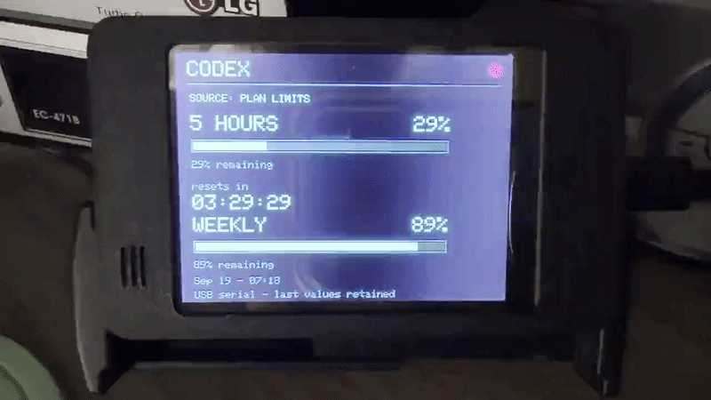
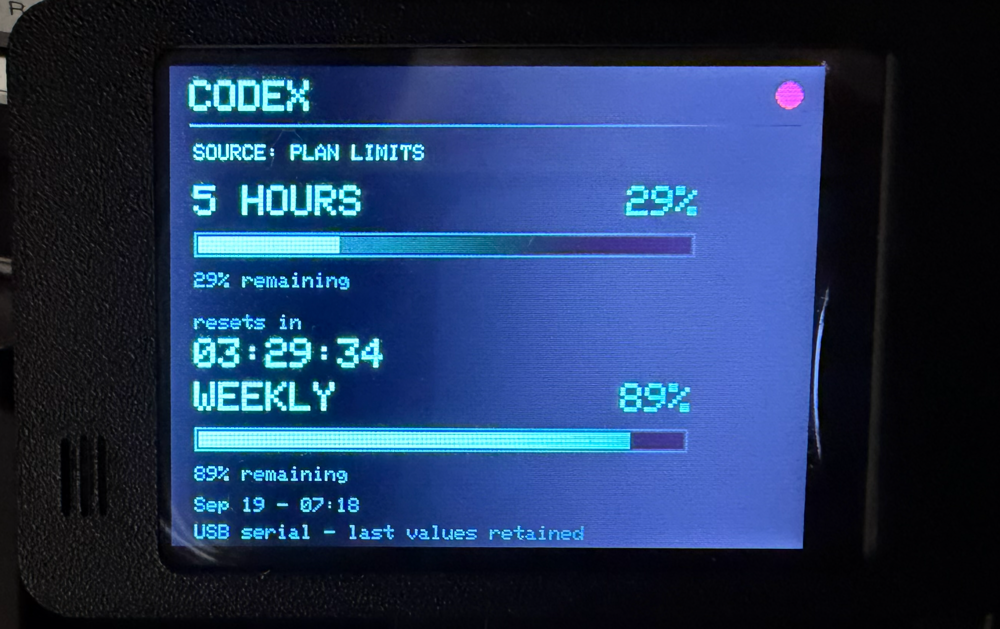
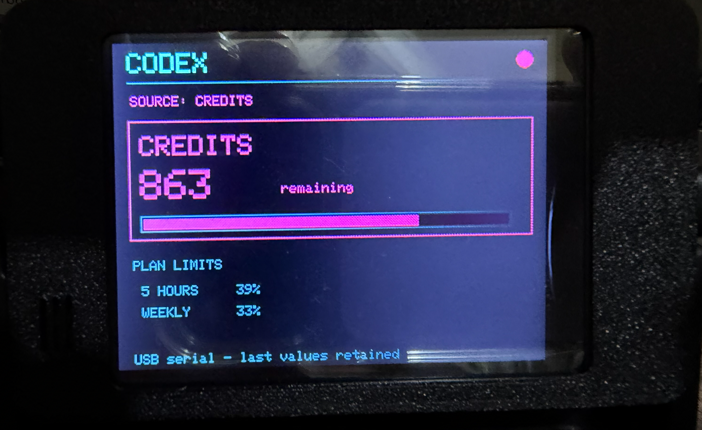

# CYD Codex Token Dashboard WiFi

<p align="center">
  
</p>

<p align="center">
  <a href="https://github.com/sponsors/icidade"></a>
  <a href="https://github.com/icidade/CYD_Codex_Token_Dashboard/actions/workflows/validate.yml"></a>
  <a href="https://github.com/icidade/CYD_Codex_Token_Dashboard/tags"></a>
  <a href="LICENSE"></a>
  <a href="https://github.com/icidade/CYD_Codex_Token_Dashboard"></a>
</p>

A tiny cyberpunk hardware dashboard for Codex usage, with **Wi-Fi updates and USB fallback**.

ESP32-2432S028R + home Wi-Fi (or USB serial) + Windows collector + Codex App Server.

**Wi-Fi mode tested successfully on real hardware (22 November 2026):** the CYD displayed live Codex limits while powered separately from a USB charger. Windows Task Scheduler started the collector automatically. See [Wi-Fi setup and test notes](README_WIFI.md).

This Wi-Fi-enabled version lives on the `feature/wifi-dashboard` branch of a fork; the original upstream project remains unchanged.

**Cyan while using plan limits. Magenta when recent credit burn is detected.**

This is an unofficial community project and is not affiliated with or endorsed by OpenAI.

## What it is

The project puts Codex rate-limit windows and recent credit-debit activity on a
320x240 Cheap Yellow Display (CYD). A small Python process asks the local Codex
App Server for a usage snapshot, normalizes it, and sends JSON over either a private home Wi-Fi connection or USB serial. The ESP32 does not sign in to ChatGPT or use an OpenAI API key.

## Dashboard modes

<table>
  <tr>
    <td align="center" width="50%">
      <br>
      <strong>Plan limits</strong><br>
      Cyan shows the remaining 5-hour and weekly allowance.
    </td>
    <td align="center" width="50%">
      <br>
      <strong>Recent credit debit</strong><br>
      Magenta appears after the collector detects a balance decrease.
    </td>
  </tr>
</table>

```text
Codex app-server
       |
       v
Python collector
       |
       | Wi-Fi (HTTP + shared key)
       | or USB serial
       v
ESP32 CYD
       |
       v
Cyberpunk dashboard
```

## Features

- 5-hour and weekly plan-limit percentages and reset times
- Optional remaining-credit display
- Local recent credit-debit detection
- Wi-Fi delivery over the home LAN (port 8080) with a locally generated shared key
- USB serial autodiscovery with identity handshake
- Reconnect, heartbeat, stale/disconnected status, and retained last values
- Rotating local logs and optional Windows Task Scheduler autostart
- No NTP, touch, SD, Bluetooth, browser scraping, or direct OpenAI API calls

## Colors and credit semantics

- **Cyan** represents plan limits.
- **Magenta** means the collector recently observed a credit balance decrease.

`credits.remaining` comes from `credits.balance` in the Codex App Server
snapshot. `credits.active` is not a service-provided or official OpenAI flag.
The collector infers it when `Decimal(current balance) < Decimal(previous
balance)` and keeps it active for a configurable short window (120 seconds by
default). Magenta therefore means *recent debit detected locally*, not “OpenAI
says credits are active.”

## Hardware

The validated target is an `ESP32-2432S028R` Cheap Yellow Display with an
ILI9341-compatible 320x240 panel in landscape orientation.

| Signal | GPIO / setting |
| --- | --- |
| TFT MISO | GPIO12 |
| TFT MOSI | GPIO13 |
| TFT SCLK | GPIO14 |
| TFT CS | GPIO15 |
| TFT DC | GPIO2 |
| TFT RST | `-1` |
| Backlight | GPIO21, active HIGH |
| Touch CS | GPIO33, held HIGH |
| Rotation | `1` |

TFT_eSPI compile-time bus definitions are grouped in `platformio.ini`.
Runtime panel settings are in `include/hardware_config.h`. The tested panel
requires `display.invertDisplay(true);` for correct colors. A different CYD
variant may need adjusted pins, driver selection, rotation, or inversion.

## Software requirements

- Python 3.10 or newer
- PlatformIO Core or the PlatformIO IDE extension
- Codex CLI, authenticated and available on `PATH`
- A USB data cable and the appropriate serial driver for your board

Tested with Python 3.11, Codex CLI `0.118.0`, and the PlatformIO dependencies
pinned in `platformio.ini`. The App Server is a local interface exposed by the
Codex CLI and can change between CLI versions.

## Wi-Fi setup (recommended)

The Wi-Fi mode uses a **2.4 GHz** network and a local key; **never commit your actual Wi-Fi password or generated key**. Instructions: [README_WIFI.md](README_WIFI.md).

The CYD connects to Wi-Fi and shows its **actual** address at the bottom of its screen. Use that address (not an example IP) when starting the Windows collector:

```powershell
python host\collector.py --wifi-host <CYD-IP-ADDRESS> --verbose
```

After confirming updates, install the autostart task with `-WiFiHost <CYD-IP-ADDRESS>` (see README_WIFI.md). Power the CYD from a USB wall adapter; the Windows PC must remain on and signed in for live data. Reserve the CYD address in your router's DHCP settings to keep it stable.

## Firmware installation

Clone the repository, then build from its root:

```powershell
python -m platformio run -t clean
python -m platformio run
```

Connect the CYD and upload only after confirming the correct serial port:

```powershell
python -m platformio run -t upload --upload-port COM3
```

## Host installation

Install the single runtime dependency:

```powershell
python -m pip install -r host\requirements.txt
```

Confirm that the Codex CLI is ready:

```powershell
codex --version
codex login status
```

The collector resolves `codex.cmd`, `codex.exe`, or `codex` through `PATH`; it
does not require a machine-specific Node/npm path.

## Usage

Print one sanitized payload without opening any serial port:

```powershell
python host\collector.py --dry-run --no-file-log
```

Start with serial autodiscovery:

```powershell
python host\collector.py
```

Useful options:

```text
--port COM3                 use a specific serial port
--vid 0x1A86               prefer a USB vendor ID
--pid 0x7523               prefer a USB product ID
--poll-interval 60         App Server polling fallback in seconds
--credit-active-window 120 recent-debit highlight duration in seconds
--log-file PATH            rotating log destination
--no-file-log              disable file logging
--verbose                  enable diagnostic output
--dry-run                  print one snapshot and exit; no serial required
```

The CH340 IDs `1A86:7523` are defaults used only to prioritize candidates.
Autodiscovery also probes other non-Bluetooth serial ports, and a device is
accepted only if it passes the protocol identity handshake.

Normal mode retries the App Server and serial connection every 5 seconds,
sends a heartbeat every 5 seconds, and polls as a 60-second fallback alongside
`account/rateLimits/updated` events.

## Windows autostart

Preview the dynamically resolved task configuration without creating a task:

```powershell
powershell -NoProfile -ExecutionPolicy Bypass -File host\install_autostart.ps1 -WhatIf
```

Install it after reviewing the preview:

```powershell
powershell -NoProfile -ExecutionPolicy Bypass -File host\install_autostart.ps1
```

The installer derives the repository root from `$PSScriptRoot`, discovers the
current Python installation, prefers the matching `pythonw.exe`, validates
`pyserial`, and stores absolute paths only inside the local Scheduled Task. Use
`-PythonPath` or `-TaskName` to override its choices.

Remove only this project's task (or the name supplied during installation):

```powershell
powershell -NoProfile -ExecutionPolicy Bypass -File host\uninstall_autostart.ps1
```

## Serial protocol

The transport is UTF-8 JSON Lines at 115200 baud. VID/PID values are discovery
hints; the identity exchange is authoritative:

```text
HOST -> WHO_ARE_YOU?
CYD  -> CYD_CODEX_DASHBOARD_V1
```

Example with fictional values:

```json
{"type":"usage","hostTime":1893456000,"utcOffsetMinutes":0,"limits":[{"id":"codex:primary","windowMinutes":300,"usedPercent":25,"remainingPercent":75,"resetsAt":1893463200}],"credits":{"remaining":100,"active":false}}
```

See [protocol/protocol.md](protocol/protocol.md) for acknowledgements,
heartbeat behavior, errors, limits, and the complete credit semantics.

## Troubleshooting

- **`Codex CLI was not found on PATH`:** install the Codex CLI and make sure
  `codex --version` succeeds in the same shell or Scheduled Task account.
- **Datasource unavailable:** confirm Codex authentication, then retry with
  `--verbose`. The experimental/local App Server interface may have changed.
- **Dashboard not found:** try another USB data cable, install the board's
  serial driver, or pass `--port`. The handshake must still succeed.
- **Wrong device is probed first:** pass `--vid` and `--pid`; these options
  change priority, not device identity.
- **Wrong colors:** confirm the tested panel needs inversion; change
  `kInvertDisplay` for another panel variant.
- **No file log wanted:** pass `--no-file-log`. Otherwise logs rotate under
  `logs/` and are ignored by Git.

## Security and privacy

The host reads usage from its local `codex app-server` subprocess. It does not read `auth.json`, browser cookies, browser DOM, or private OpenAI HTTP endpoints, and it never sends OpenAI login credentials to the ESP32. In Wi-Fi mode it sends only usage snapshots to a local CYD HTTP endpoint, protected by a generated shared key. **LAN traffic is not encrypted; do not port-forward port 8080 or use on untrusted networks.** Local logs and build
artifacts are ignored. The included media shows point-in-time dashboard values
but contains no credentials or account identifiers. Contributors should review
and redact sensitive information before attaching their own screenshots.

## Limitations

- The Codex App Server is not a stable public API and may change between CLI
  releases.
- Credit activity is inferred by comparing snapshots and is lost when the host
  process restarts.
- Credit balances are normalized to an integer for the current firmware.
- The included hardware profile targets one common CYD variant; clones differ.
- Wi-Fi mode requires a reachable private LAN, and its IP may change without a router DHCP reservation.

## Contributing

Issues and focused pull requests are welcome. Do not attach real App Server
payloads, logs, credentials, account data, or unredacted dashboard photos.
When adding a board variant, document its exact controller, pins, rotation, and
display inversion behavior.

## License

Released under the [MIT License](LICENSE).
